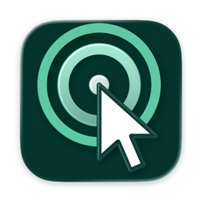
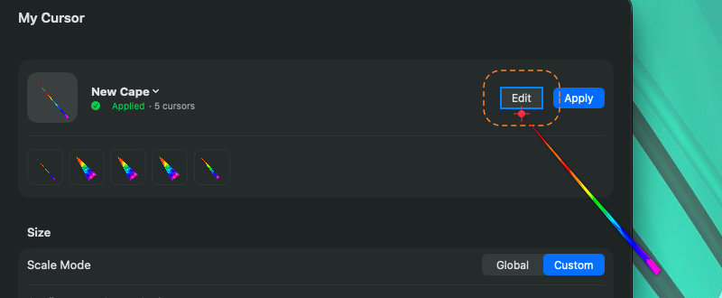
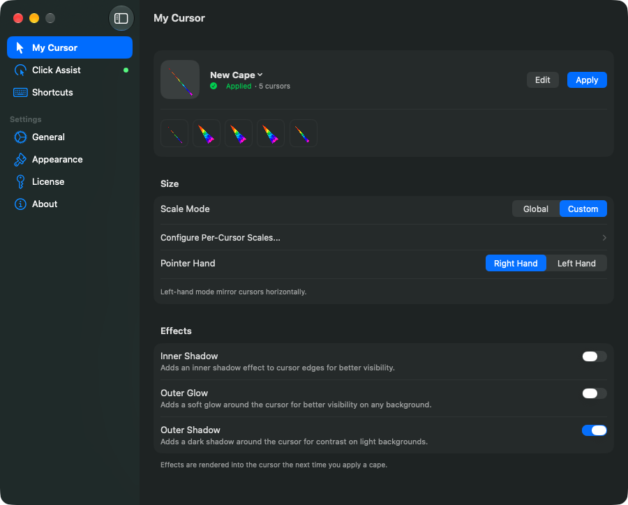
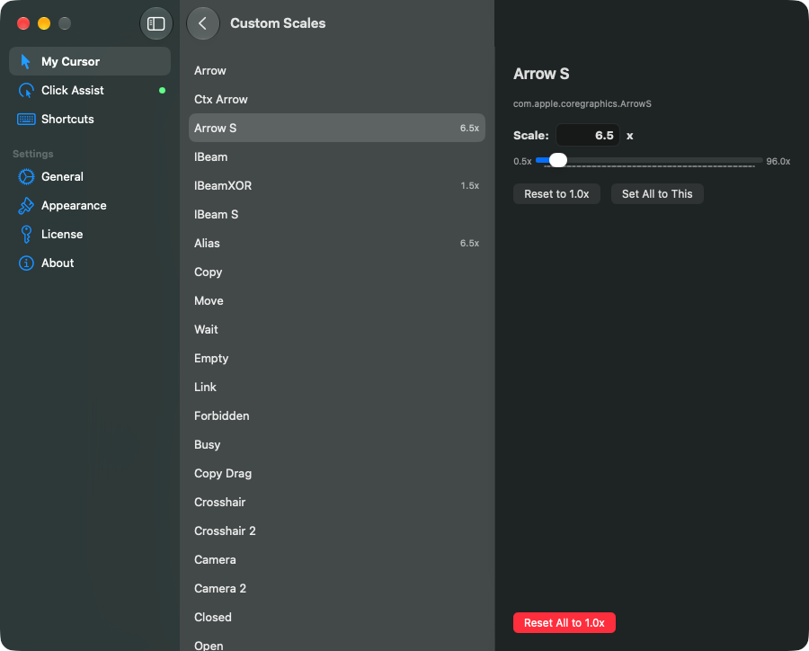
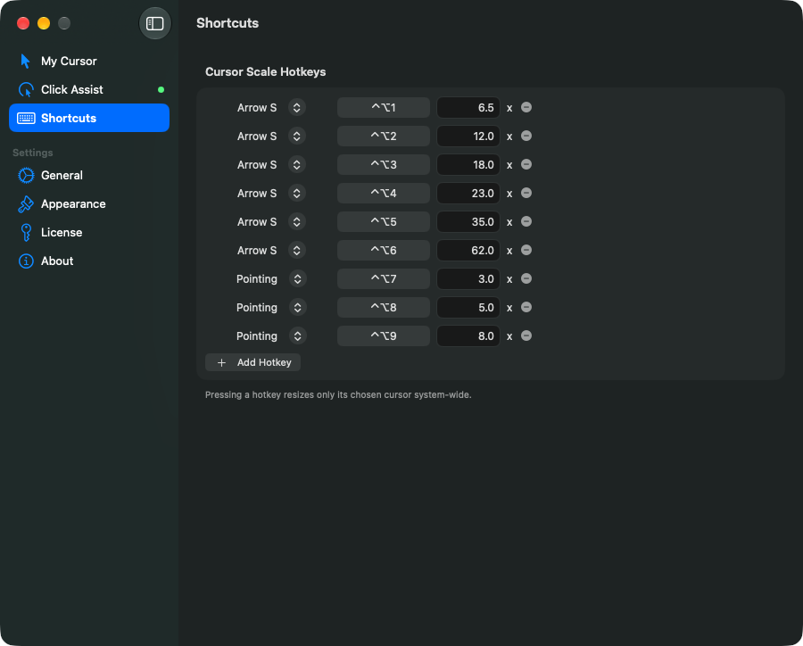
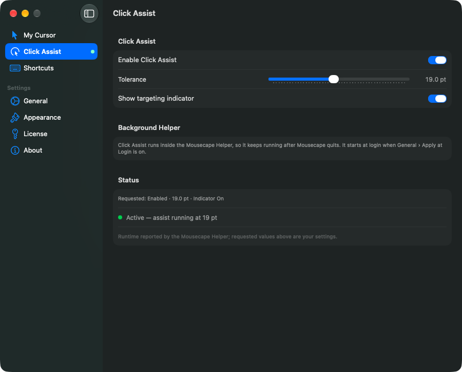
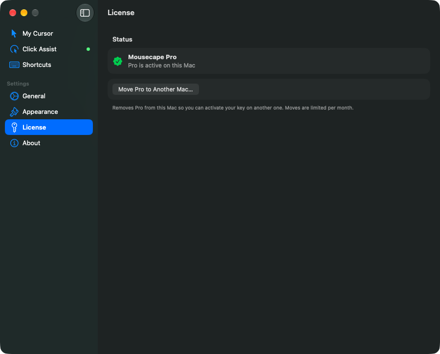
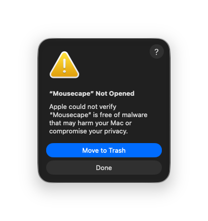
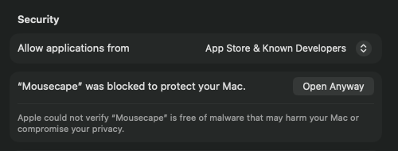

<div align="center">



# Mousecape

**Custom cursors for your Mac — and clicks that land where you meant.**

[**⬇ Download the latest version**](../../releases/latest) · Free · macOS 15 or later

</div>

<p align="center">
  
</p>

---

## What it does

Mousecape replaces the macOS pointer with any cursor you like — static or animated, at any size. **Mousecape Pro** adds Click Assist, which makes small buttons and checkboxes easier to hit.

## Free features

- **Custom cursors** — replace the arrow, text, link, resize and wait cursors with your own static or animated designs.
- **Big, sharp cursors** — scale every cursor together, or each one on its own, up to 96×.
- **Windows cursor import** — drop in a Windows cursor pack (`.cur` / `.ani`) and Mousecape maps it for you.
- **Easy editor** — drag in images or GIFs, set the click point, preview before you apply.
- **Visibility effects** — inner shadow, outer glow and outer shadow help the pointer stand out on any background.
- **Size hotkeys** — press a shortcut to resize one cursor instantly, anywhere on your Mac.
- **Left-hand mode** — mirror every cursor with one switch.
- **Stays applied** — a small menu bar helper puts your cursor back after sleep, display changes and restarts.

<p align="center">
  
</p>

## Per-cursor sizes

Make the arrow huge while keeping the text cursor slim. In **Custom** scale mode, every cursor type gets its own size from 0.5× to 96×, with a slider or an exact number.

- **Set All to This** copies one size to every cursor; **Reset All to 1.0×** starts over.
- The list shows which cursors you've resized at a glance.

<p align="center">
  
</p>

## Size hotkeys

Need a bigger pointer for a presentation, then back to normal? Set up hotkeys that resize a chosen cursor system-wide, for example ⌃⌥1 for a small arrow and ⌃⌥6 for a huge one.

- Pick the cursor, the key combination and the size (up to 96×) for each hotkey.
- Add as many as you like; each one changes only its own cursor.

<p align="center">
  
</p>

## Mousecape Pro — Click Assist

Small targets are hard to hit, especially with a large cursor or a trackpad. Click Assist watches where you're pointing and, when your click is just next to a button, checkbox or link, lands it on that target instead.

- **Targeting ring** shows which control your click will hit before you press.
- **Adjustable tolerance** — choose how far from a target Click Assist reaches.
- **Works everywhere** — in apps and on websites, including small shopping-cart checkboxes and video seek bars.
- **Runs in the background** — keeps working after you close the Mousecape window.

<p align="center">
  
</p>

## Pricing

| | Mousecape | Mousecape Pro |
|---|:---:|:---:|
| Custom cursors, editor, scaling, effects | ✓ | ✓ |
| Windows cursor import | ✓ | ✓ |
| Size hotkeys | ✓ | ✓ |
| Click Assist | — | ✓ |
| **Price** | **Free** | **US$1.99, one-time** |

- One payment, no subscription. Pro is active on one Mac at a time.
- Switching Macs? Use **Move Pro to Another Mac** on the License page, then activate on the new one.
- Lost your key? Use **Recover by email** on the License page.

Buy or activate Pro inside the app: **Mousecape → License**. Payment is handled securely by Stripe.

<p align="center">
  
</p>

## Install

1. [Download the latest `Mousecape-v….zip`](../../releases/latest) and double-click it to unzip.
2. Drag **Mousecape.app** into your **Applications** folder.
3. Double-click **Mousecape** to open it. The first time, follow **First launch: Open Anyway** below.
4. To use Click Assist, click **Grant Accessibility…** on the Click Assist page and allow Mousecape in **System Settings → Privacy & Security → Accessibility**.

## First launch: Open Anyway

Mousecape is distributed outside the Mac App Store and hasn't been through Apple's notarization yet, so the first time you open it macOS asks you to confirm. It takes about 30 seconds:

**1. Click Done.** macOS shows "Mousecape" Not Opened. Click **Done** — not *Move to Trash*.

<p align="center">
  
</p>

**2. Open Privacy & Security.** Choose the **Apple menu → System Settings → Privacy & Security**, then scroll down to **Security**.

**3. Click Open Anyway.** Next to "Mousecape" was blocked to protect your Mac, click **Open Anyway**.

<p align="center">
  
</p>

**4. Confirm.** Enter your Mac login password (or use Touch ID) when asked. If macOS asks once more whether to open Mousecape, click **Open Anyway**. macOS remembers your choice, so you only do this once.

> The **Open Anyway** button only appears for about an hour after you try to open the app. If you don't see it, double-click Mousecape again, click **Done**, and go back to step 2.

<details>
<summary>Prefer Terminal?</summary>

After moving Mousecape to Applications, run this once, then open the app normally:

```bash
xattr -dr com.apple.quarantine /Applications/Mousecape.app
```

</details>

Apple's guide: [Open a Mac app from an unknown developer](https://support.apple.com/guide/mac-help/open-a-mac-app-from-an-unknown-developer-mh40616/mac).

**Requirements:** macOS Sequoia (15) or later, on a Mac with Apple silicon.

## Updates

Mousecape checks this page for new versions: **Settings → About → Check for Updates**. It installs an update only if it's newer than your current version and signed by the same developer.

## Help & feedback

- Cursor not changing? If you changed the pointer colour in **System Settings → Accessibility → Display → Pointer**, click **Reset Color** there, then apply again.

- Found a bug or have an idea? [Open an issue](../../issues).
- Privacy: Mousecape doesn't collect data. Pro talks to the license server only to buy, activate and check your license — see the [privacy policy](PRIVACY.txt).

## Credits

Mousecape builds on the original Mousecape by [Alex Zielenski](https://github.com/alexzielenski) and the SwiftUI redesign by [sdmj76](https://github.com/sdmj76), used under the Apache License 2.0 ([LICENSE](LICENSE)).
